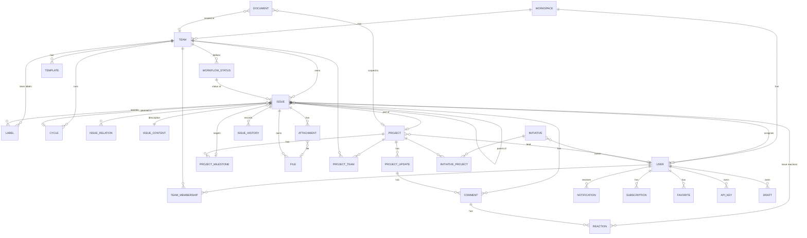

# Surface: Domain Model

Status: **Draft v0.1** · Date: 2026-11-06 · Implements: PRD §5 · Related: [glossary](glossary.md), [state machines](state-machines.md), [permissions](permissions.md), [events](events.md)

*Changed 2026-11-12 (M1 acceptance gate, SPEC-010 to SPEC-015 §12): labels are `labelIds` on Issue (no IssueLabel); the description moves to IssueContent; new fields on Team, Label, Issue, IssueHistory, Comment, Reaction, Attachment and File; the new `Draft` model; archive is automatic for issues and issues are read-only while archived or deleted; INV-07 and INV-08 reworded, INV-23 to INV-26 added; the operations catalogue follows the M1 specs.*

---

## 1. Conventions (all entities)

| Convention | Rule |
|---|---|
| **IDs** | `UUIDv7` (time-ordered). **Generated by the client** for optimistic creates, and validated for uniqueness by the server. |
| **Common fields** | `id`, `createdAt`, `updatedAt` (server-set, UTC), and `creatorId` where it makes sense |
| **Archive** | `archivedAt?`. Issues (and later projects and cycles) are archived only by the automatic job, and an issue comes back only by restore (see [state machines](state-machines.md) §2). Labels are the exception: people archive and unarchive them by hand (SPEC-010). An archived label stays in the replica; an archived issue leaves it and is read from the server ([ADR-0020](../04-architecture/adr/0020-partial-issue-sync.md)). |
| **Soft delete** | `deletedAt?`. A deleted issue is shown as **Recently deleted** and can be restored for 30 days. Then it is **purged** (a hard delete): the Issue and its eager children each log a `D` delta, its content rows log none (SPEC-015 §4.5). |
| **Manual order** | `sortOrder`: a fractional-index string (e.g. `"a0V"`). It allows inserting between two rows without renumbering. |
| **Calendar dates** | `YYYY-MM-DD` with no timezone (due date, target date). Instants are `timestamptz`. |
| **Rich text** | Stored as editor JSON (ProseMirror). The plain text used for search is derived by the server and kept in a server-only table (`issue_search_text`, `comment_search_text`), never synced (SPEC-011 §4.3, SPEC-013 §4.1). |
| **Enums** | Stored as strings in the DB. Priority is a small int (0–4). |
| **Sync scope** | Every entity is **Synced** (in the replica, scoped by sync group), **User-scoped** (synced only to its owner), or **Server-only** (never sent to clients; read through admin queries). See [permissions.md](permissions.md). A synced model is **eager** (in bootstrap and kept live) or **content** (loaded per parent issue when needed, declared with a `parent`; SPEC-011 §5.2). |

---

## 2. Entity index

| Area | Entity | Sync scope |
|---|---|---|
| Workspace | Workspace (singleton) | Synced (`workspace`) |
| Identity | User | Synced (`workspace`). Secret fields are server-only. |
| | Session, MagicLinkToken, PasswordResetToken, Invite, UserCredentials, TeamIssueCounter | Server-only |
| | ApiKey | User-scoped (the hash is server-only) |
| Teams | Team, TeamMembership | Synced (`workspace`, or `team:<id>` if private) |
| Workflow | WorkflowStatus, Label | Synced (inherits the team's scope; workspace labels use `workspace`) |
| Issues | Issue | Synced, eager: `team:<teamId>`; a public team's issue is also in `user:<creatorId>` and `user:<assigneeId>` ([ADR-0020](../04-architecture/adr/0020-partial-issue-sync.md)) |
| | Attachment, IssueIdentifierAlias | Synced, eager (the issue's `team:<teamId>` group only) |
| | IssueRelation | Synced, eager (the intersection of both issues' groups, permissions §2) |
| | IssueContent, IssueHistory, Comment, Reaction | Synced, content, parent Issue (`team:<teamId>` only). Comments on project updates (M5) take the project's scope. |
| | File | Server-only (read through `GET /files/:id`, SPEC-014) |
| Planning | Cycle | Synced (team scope) |
| | Project, ProjectTeam, ProjectMember, ProjectMilestone, ProjectUpdate | Synced (derived from the project's teams; see permissions §3) |
| | Initiative, InitiativeProject | Synced (`workspace`) |
| Knowledge | Document, Template | Synced (inherits the scope it belongs to) |
| Personal | CustomView (shared) | Synced (workspace or team scope) |
| | CustomView (personal), ViewPreference, Favorite, Subscription, Notification, Draft | User-scoped |
| Platform | Webhook, WebhookDelivery, AuditLogEntry | Server-only (Admin queries) |

---

## 3. Entity relationship diagram (core)



---

## 4. Entities

> Fields marked 🔒 are server-only and never synced to clients.

### 4.1 Workspace (singleton)
| Field | Type | Notes |
|---|---|---|
| name | string (1–64) | |
| logoFileId | File? | |
| signupPolicy | `invite_only` \| `domain` | Default `invite_only` |
| allowedDomain | string? | Required when `signupPolicy = domain` |
| mcpEnabled | bool | Default `true` |
| updateReminder | `{ weekday, hour }?` | Schedule for project update reminders |
| defaults | json | Default settings for new teams |

### 4.2 User
| Field | Type | Notes |
|---|---|---|
| email | string | Unique, stored lowercase |
| name, displayName | string | displayName is unique and used for @mentions |
| avatarFileId | File? | |
| timezone | IANA tz | |
| role | `admin` \| `member` | |
| active | bool | Deactivated users can't log in, but remain referenced |
| passwordHash 🔒 | string? | argon2id, in the server-only **UserCredentials** row (§4.16), not on User: User is synced, and every write to it is broadcast. No row if the user only uses magic links. |
| lastSeenAt 🔒 | timestamptz | Not stored on User: the latest `Session.lastUsedAt` (§4.16). |
| preferences | → UserPreferences | Theme, home view, font size. A separate row (`UserPreferences`, id = the user's id, `values` json) synced to `user:<id>` only, because the User row itself is `workspace` (PLAN-001 S1). |

### 4.3 Team / TeamMembership
| Field | Type | Notes |
|---|---|---|
| key | string `^[A-Z]{2,5}$` | Unique. Changing it is v2. |
| name, icon, color | | |
| timezone | IANA tz | Drives cycle boundaries and automations |
| private | bool | |
| triageEnabled | bool | |
| defaultStatusId | WorkflowStatus | Must be in the Backlog or Unstarted category |
| estimateScale | `off` \| `linear` \| `exponential` \| `fibonacci` \| `tshirt` | Values per scale: SPEC-010 §4.3 |
| estimateExtended | bool | Default false. Adds two larger values to the scale (SPEC-010 §4.3). |
| estimateAllowZero | bool | Default false. Allows the estimate 0 on any scale (0 is not "no estimate"). |
| estimateCountUnestimatedAsOne | bool | Default true. Read only by cycle statistics (M3). |
| cyclesEnabled, cycleDurationWeeks (1–8), cycleCooldownWeeks (0–2), cycleStartWeekday (0–6), cycleUpcomingCount (1–15), cycleAutoAddStarted, cycleAutoAddCompleted | | Cycle settings |
| autoArchiveMonths | int | One of 1, 3, 6, 9, 12. Default 6. Never null: archive is always on (SPEC-015 §3.2). |
| autoCloseMonths | int? | Null (off, the default) or one of 1, 3, 6, 9, 12 |
| autoCloseStatusId | WorkflowStatus? | A Canceled-category status of the team. Set whenever auto-close is on, null while it is off. A status it names can't be deleted (SPEC-015 §4.9, SPEC-010 §6). |
| parentAutoComplete | bool | Default false |
| issueCounter 🔒 | int | Last issue number assigned. Kept in the server-only **TeamIssueCounter** row (§4.16), so taking a number isn't a sync delta. |

**TeamMembership:** `teamId`, `userId`, `triageResponsible: bool`. Unique on (`teamId`, `userId`).

### 4.4 WorkflowStatus
| Field | Type | Notes |
|---|---|---|
| teamId | Team | |
| name | string | Unique within the team |
| category | `triage` \| `backlog` \| `unstarted` \| `started` \| `completed` \| `canceled` \| `duplicate` | |
| color, description | | |
| position | fractional key | Order *within* the category (§1, manual order) |

### 4.5 Label
| Field | Type | Notes |
|---|---|---|
| teamId | Team? | Null = workspace label. A team label (or a team group with its labels) can move to the workspace (`label.moveToWorkspace`); a workspace label never moves to a team (SPEC-010 D11). |
| name | string (1–50) | Unique within its scope and group, archived labels included (case-insensitive). Can't contain `/` or `:` (they separate a group from a label) and can't be a reserved filter word (`assignee`, `cycle`, `effort`, `estimate`, `hours`, `priority`, `project`, `state`, `status`). |
| color, description | | Description 0–255 characters |
| parentId | Label? | Set when this label belongs to a group. The group is a live group of the same scope. |
| isGroup | bool | Fixed at creation. A group cannot be applied to an issue directly. |
| exclusive | bool | Groups only. Default true (single-select: an issue holds at most one label of the group, INV-07). False: multi-select. |
| archivedAt | timestamptz? | Synced. Set and cleared by hand (`label.archive`, `label.unarchive`). An archived label stays on its issues but can't be newly added. Archiving a group archives its labels; unarchiving it unarchives them. |

Limits: at most 500 labels per scope and 250 per group, archived labels included (SPEC-010 §4.2). Issues hold labels as `Issue.labelIds` (§4.6); there is no IssueLabel model (SPEC-011 §4.2). Deleting a label removes it from every issue's `labelIds`, as a settings change with no history (SPEC-011 §4.9).

### 4.6 Issue
| Field | Type | Notes |
|---|---|---|
| teamId | Team | |
| number | int? | Assigned by the server on commit. Null only while an optimistic create is pending. |
| title | string (1–255) | Trimmed; line breaks become spaces |
| statusId | WorkflowStatus | Must belong to `teamId` |
| priority | 0–4 | Default 0 |
| assigneeId | User? | Must be active and, if the team is private, a member |
| labelIds | uuid[] | Labels of the team or workspace labels (INV-06), never a group, not archived when added. At most 20. Stored in insertion order (SPEC-011 §4.2). |
| estimate | int? | Valid on the team's estimate settings **when written** (scale, Extended, Allow zero; SPEC-010 §4.3). Changing the settings never rewrites stored values. |
| dueDate | date? | |
| projectId | Project? | |
| projectMilestoneId | ProjectMilestone? | Must belong to `projectId` |
| cycleId | Cycle? | Must belong to `teamId` and must not be completed |
| parentId | Issue? | |
| sortOrder | fractional key | Global manual order. Computed by the server: a new issue goes first, before the team's lowest key, with a random suffix. Reads order by (`sortOrder`, `id`) (SPEC-011 §4.5). |
| subIssueSortOrder | fractional key? | Order under the parent |
| startedAt, completedAt, canceledAt, triagedAt | timestamptz? | Maintained automatically from category changes |
| snoozedUntil | timestamptz? | Triage snooze only |
| archivedAt | timestamptz? | Set only by the auto-archive job, cleared only by restore. Synced. |
| deletedAt, deletedById | timestamptz?, User? | Set by `issue.delete`, cleared by restore |

The description is not on the Issue row: it is the content model **IssueContent** (below). Archived and deleted issues are read-only: every direct edit is `CONFLICT` until the issue is restored (SPEC-015 §4.3).

**IssueContent** (content, parent Issue): `id` = `issueId`, `teamId` (equal to the issue's), `description` (editor JSON, at most 200 KB; empty is `EMPTY_DOC`), `version` (starts at 1, +1 per save; used for conflict detection). The plain text for search is server-only (§1).

**Identifier** = `team.key + "-" + number`. It is derived, not stored.
**IssueIdentifierAlias:** `identifier` (unique), `issueId`. Written when an issue moves between teams, so old IDs keep resolving.

### 4.7 IssueRelation
| Field | Type | Notes |
|---|---|---|
| issueId | Issue | The *source* |
| relatedIssueId | Issue | The *target* |
| type | `blocks` \| `related` \| `duplicate` | `A blocks B` is stored once, and "B blocked by A" is its inverse view. `A duplicate B` means A is a duplicate of the canonical issue B. |

### 4.8 Comment / Reaction
| Field | Type | Notes |
|---|---|---|
| issueId \| projectUpdateId | | Exactly one is set (`projectUpdateId` arrives in M5) |
| teamId | Team | The issue's team, copied at creation (sync group and API key filter) |
| parentCommentId | Comment? | One level of replies only |
| userId | User | Author. For `api` and `mcp`, the key's owner. |
| actorKind | `user` \| `api` \| `mcp` | Shown as "via API" or "via MCP". A `system` kind is deferred. |
| body | doc | Editor JSON, at most 50 KB. Its search text is server-only (§1). |
| version | int | Starts at 1, +1 on every body change. `comment.update` takes `baseVersion` and is `CONFLICT` when it differs. |
| editedAt, deletedAt | | A deleted comment that has replies shows as "deleted" |
| resolvedAt, resolvedById | timestamptz?, User? | Top-level comments only (a resolved thread). Set by `comment.resolve`, cleared by `comment.reopen`, always together (INV-23). |

**Reaction:** `emoji`, `userId`, `issueId`, `teamId`, and `commentId?` (empty: a reaction on the issue itself), or `projectUpdateId` (M5). The id is derived from (comment or issue, user, emoji), so it is unique on that triple and the client and server compute the same id. Set with `reaction.set`.

### 4.9 Attachment / File
- **Attachment** (eager, synced in `team:<teamId>`): `issueId`, `teamId` (the issue's), `kind` (`file` | `link`), `title` (1–255), `url?` (links: `http` or `https`, at most 2,048 characters), `fileId?`, `fileName?`, `mimeType?`, `size?` (files, copied from the file row), `imageWidth?`, `imageHeight?`, `previewFileId?` (set by the system-only `attachment.setPreview`), `creatorId`. At most 100 per issue (SPEC-014 §4.1).
- **File** (server-only, never synced): `storageKey` 🔒, `name`, `mimeType`, `size` (`bigint`), `uploaderId`, `purpose` (`avatar`, `logo`, `attachment`, `inline`, `preview`), `issueId?` (the owning issue once claimed; never changes), `detachedAt?` (an `attachment` file whose attachment was removed), `previewOf?` (for a preview, its source file), `width?`, `height?`. Bytes live on the uploads volume, content-addressed, so several rows can share one `storageKey`; every insert and delete follows SPEC-014's byte protocol. Avatars and the logo are one 256 px WebP (SPEC-001 D12). Who can read a file is permissions §4.

### 4.10 IssueHistory
| Field | Type | Notes |
|---|---|---|
A content model, parent Issue (SPEC-011 §4.4).

| Field | Type | Notes |
|---|---|---|
| issueId | Issue | |
| teamId | Team | The issue's team (sync group and API key filter) |
| kind | `created` \| `updated` \| `deleted` \| `restored` \| `archived` | `deleted`, `restored` and `archived` have empty `changes`. `archived` is written only by the auto-archive job. There is no `unarchived` kind and no `archived` field inside an `updated` entry: only restore returns an issue from archive. Later milestones add kinds (e.g. `moved_team`). |
| actorKind | `user` \| `api` \| `mcp` \| `system` | |
| actorId | User? | Null for `system`. For `api` and `mcp`, the key's owner. |
| apiKeyId | ApiKey? | For `api` and `mcp` |
| changes | json | `{ field: { from, to } }`. A reference is stored with a **name snapshot** (`{id, name, …}`), so the entry stays readable after the row is renamed or deleted. Labels and attachments are `{ added: […], removed: […] }`. The description is `description: true`, never its text. |
| createdAt, updatedAt | timestamptz | `updatedAt` moves when an entry is folded |

- **Creator fold:** a change by the issue's creator within 3 minutes of creation is merged into the `created` entry.
- **Description fold:** a description-only change is merged into the same actor's description-only `updated` entry when that entry is the issue's latest and at most 10 minutes old.
- **No snapshot of what a viewer can't see:** an entry never stores the name of a row that some viewer of the issue can't see.

### 4.11 Cycle
| Field | Type | Notes |
|---|---|---|
| teamId | Team | |
| number | int | Sequential per team |
| name, description | string? | Default display name is "Cycle N" |
| startsAt, endsAt | timestamptz | Computed in the team's timezone at 00:00 |
| completedAt | timestamptz? | |
| snapshot | json? | Frozen at completion: daily scope, started, and completed points |

### 4.12 Project & children
**Project**

| Field | Type | Notes |
|---|---|---|
| name, icon, color, summary | | |
| description / descriptionText | doc / text | Overview |
| status | `backlog` \| `planned` \| `in_progress` \| `paused` \| `completed` \| `canceled` | A fixed set in v1 |
| priority | 0–4 | |
| leadId | User? | |
| leadTeamId | Team | Must also appear in ProjectTeam |
| startDate, targetDate | date? | `startDate ≤ targetDate` |
| startedAt, completedAt, canceledAt | | Set automatically |
| sortOrder, archivedAt, deletedAt | | |

The other project entities:
- **ProjectTeam:** (`projectId`, `teamId`), unique.
- **ProjectMember:** (`projectId`, `userId`), unique.
- **ProjectMilestone:** `projectId`, `name`, `description`, `targetDate?`, `sortOrder`.
- **ProjectUpdate:** `projectId`, `authorId`, `health` (`on_track` | `at_risk` | `off_track`), `body`, `progressSnapshot` (json), `editedAt?`, `deletedAt?`.

### 4.13 Initiative
**Initiative:** `name`, `description`, `ownerId`, `status` (`planned` | `active` | `completed`), `targetDate?`, `sortOrder`, `archivedAt`, `deletedAt`.
**InitiativeProject:** (`initiativeId`, `projectId`) with a `sortOrder`. A project may belong to **several** initiatives.

### 4.14 Document / Template
- **Document:** `title`, `icon`, `content` / `contentText`, `teamId?`, `projectId?` (both null means workspace scope; at most one is set), `creatorId`, `sortOrder`, `deletedAt`.
- **Template:** `teamId`, `name`, `kind` (`issue`; `document` in v2), `data` (json: property defaults and description doc).

### 4.15 Views & personal data
- **CustomView:** `name`, `icon`, `model` (`issue` | `project`), `teamId?` (null means workspace scope), `ownerId`, `visibility` (`shared` | `personal`), `filters` (json, see [Filter model](#5-filter-model)), `display` (json), `sortOrder`.
- **ViewPreference:** (`userId`, `viewKey`), unique. `display` json holds personal overrides. `viewKey` is a custom view ID or a built-in key such as `team:<id>:active`.
- **ViewDefault:** (`viewKey`), with the shared default display for built-in views ("set as default for everyone").
- **Favorite:** `userId`, `targetType`, `targetId`, `sortOrder`.
- **Subscription:** (`userId`, `targetType` ∈ {issue, project}, `targetId`), unique. Also holds `reason` (`creator` | `assignee` | `mention` | `commenter` | `manual` | `lead` | `member`) and `active` (false = explicitly unsubscribed, so auto-subscribe does not re-add the user).
- **Draft** (user-scoped, synced in `user:<id>` only): `userId` (the owner, set by the server), `kind` (`composer` | `comment`), `teamId?` (composer: one draft per user and team), `issueId?` (comment: one draft per user and issue), `data` (json), `updatedAt`. At most 50 comment drafts per user (SPEC-012 §4.3).
- **Notification:** `userId`, `type` (see [events.md](events.md)), `issueId?`, `projectId?`, `projectUpdateId?`, `commentId?`, `actorId?`, `data` (json), `groupKey` (e.g. `issue:<id>`), `readAt?`, `snoozedUntil?`, `deletedAt?`.

### 4.16 Identity, platform & audit (server-only unless noted)
| Entity | Key fields |
|---|---|
| Session | userId, tokenHash, userAgent, ip, createdAt, lastUsedAt, expiresAt |
| UserCredentials | userId (primary key), passwordHash (argon2id), updatedAt |
| TeamIssueCounter | teamId (primary key), lastNumber. Upserted when an issue is created. |
| Invite | email?, tokenHash, role, invitedById, expiresAt, acceptedAt?, revokedAt? |
| MagicLinkToken / PasswordResetToken | userId, tokenHash, expiresAt (15 min / 1 h), usedAt? |
| ApiKey (user-scoped) | userId, name, prefix (`sfc_xxxx`), keyHash 🔒, scope (`read` \| `read_write`), teamIds?, allowDestructive, lastUsedAt, revokedAt? |
| Webhook | url, secret 🔒, events[], enabled, createdById |
| WebhookDelivery | webhookId, event, payload, attempt, status, responseCode, nextAttemptAt |
| AuditLogEntry | actorId?, actorKind, action, targetType, targetId, ip, data, createdAt |

---

## 5. Filter model

A filter is a JSON tree shared by views, the API (`*.list`), and MCP:

```json
{ "and": [
    { "field": "status.category", "op": "in", "value": ["unstarted", "started"] },
    { "field": "assignee", "op": "eq", "value": "me" },
    { "or": [ { "field": "priority", "op": "lte", "value": 2 }, { "field": "label", "op": "in", "value": ["bug"] } ] },
    { "field": "updatedAt", "op": "gte", "value": "-P14D" }
] }
```

- **Operators:** `eq`, `neq`, `in`, `nin`, `lt`, `lte`, `gt`, `gte`, `exists`, `contains` (text).
- **Relative values:** `me`, `current`/`next`/`previous` for cycles, and ISO-8601 durations for dates.
- The client evaluates filters **locally** against the replica. The server evaluates the same tree for the API and MCP, so both share one implementation in the shared package.

---

## 6. Invariants

Each invariant must hold after every committed transaction. The server enforces them, and each has a test.

| ID | Invariant |
|---|---|
| INV-01 | Exactly one Workspace exists. At least one **active Admin** exists at all times. |
| INV-02 | `User.email` is unique (case-insensitive). `User.displayName` is unique (case-insensitive: it is the @mention handle). |
| INV-03 | `Team.key` is unique and matches `^[A-Z]{2,5}$`. |
| INV-04 | Every team has ≥ 1 status in each of the categories Backlog, Unstarted, Started, Completed, and Canceled. It has exactly one system Duplicate status, and exactly one Triage status (which exists even when triage is disabled). |
| INV-05 | `Team.defaultStatusId` refers to a status of that team in the Backlog or Unstarted category. |
| INV-06 | `Issue.statusId`, `Issue.cycleId`, and every team-scoped label on an issue belong to `Issue.teamId`. |
| INV-07 | Adding a label of an **exclusive** label group never leaves two labels of that group on an issue: it is enforced when an issue's labels are written, and the new label replaces the others of its group. A multi-select group has no limit. Groups themselves are never applied to issues. Label groups are one level deep. *Changed (SPEC-010 D10, SPEC-011 §4.2): was "at most one label per label group".* |
| INV-08 | `(teamId, number)` is unique among issues. A **committed** number is never reused, even after purge: the team's counter never goes down. *Changed (SPEC-011 D1): numbers are gap-free in commit order, since a rolled-back create rolls back its counter too.* |
| INV-09 | An issue's parent chain has no cycles. `parentId ≠ id`. |
| INV-10 | `IssueRelation`: no self-relations. At most one relation per (unordered pair, type). An issue has at most one `duplicate` relation as the source. |
| INV-11 | An issue is in the **Duplicate** category if and only if it is the source of a `duplicate` relation. |
| INV-12 | `Issue.projectMilestoneId` is set only if it belongs to `Issue.projectId`. Changing the project clears the milestone. |
| INV-13 | `Issue.cycleId` never points to a completed cycle for an open issue. Closed issues may stay in completed cycles. |
| INV-14 | A Triage-category issue has no `cycleId`. |
| INV-15 | Each team's cycles don't overlap and are numbered consecutively. |
| INV-16 | `Project.leadTeamId` ∈ the project's ProjectTeam rows. A project has ≥ 1 team. |
| INV-17 | An issue's team must be one of its project's teams. Adding an issue to a project adds the issue's team to the project automatically. |
| INV-18 | The assignee of an issue in a private team is a member of that team. Removing a member unassigns them from that team's open issues. |
| INV-19 | Comment replies are one level deep: a reply's parent has no parent. |
| INV-20 | Timestamps (`startedAt`, `completedAt`, `canceledAt`) are consistent with the current status category (see [state machines](state-machines.md) §1). |
| INV-21 | Purged records leave no dangling references: references are nulled, or rows cascade-deleted, per the rules in permissions §6. |
| INV-22 | `Document` has at most one of `teamId` / `projectId`. |
| INV-23 | Only a top-level comment is resolved. `resolvedAt` and `resolvedById` are set together or are both null (SPEC-013 §4.5). |
| INV-24 | A reaction is unique per (subject, user, emoji), where the subject is a comment or the issue (SPEC-013 §4.5). |
| INV-25 | Every child row of an issue (IssueContent, IssueHistory, Comment, Reaction, Attachment) carries its issue's `teamId` (SPEC-011 D4). |
| INV-26 | A reply's `issueId` equals its parent comment's, and a comment reaction's `issueId` equals its comment's (SPEC-013 §4.5). |

---

## 7. Operations catalogue (seed for the Operation Registry)

The domain is changed **only** through operations. This first-pass list will be refined in the specs. ⚙️ marks a **system-only** operation (`systemOnly`, SPEC-003 §3.1): only the system actor runs it, and it is hidden from the API, MCP and the command menu.

| Domain | Queries | Mutations |
|---|---|---|
| workspace | `workspace.get` | `workspace.update` |
| user | `user.list`, `user.get`, `user.me` | `user.updateProfile`, `user.setRole`, `user.deactivate`, `user.reactivate` |
| invite | `invite.list` | `invite.create`, `invite.revoke` |
| team | `team.list`, `team.get` | `team.create`, `team.update`, `team.setPrivacy`, `team.addMember`, `team.removeMember`, `team.join`, `team.leave`, `team.setDefaultStatus`, `team.setEstimates`, `team.updateAutomations` |
| status | `status.list` | `status.create`, `status.update`, `status.reorder`, `status.delete` (refused while any issue uses the status) |
| label | `label.list`, `label.usage` | `label.create`, `label.update`, `label.moveToWorkspace`, `label.archive`, `label.unarchive`, `label.delete` |
| issue | `issue.get`, `issue.list`, `issue.search`, `issue.count`, `issue.groupBy`, `issue.listDeleted` | `issue.create`, `issue.bulkCreate`, `issue.update`, `issue.updateDescription`, `issue.bulkUpdate`, `issue.moveTeam`, `issue.setParent`, `issue.delete`, `issue.restore`, `issue.purge`, ⚙️ `issue.autoArchive`, ⚙️ `issue.autoClose`. No `issue.archive` or `issue.unarchive`: archive is automatic only. |
| relation | — | `relation.create`, `relation.delete`, `issue.markDuplicate` |
| comment | `comment.list` | `comment.create`, `comment.update` (takes `baseVersion`), `comment.delete`, `comment.resolve`, `comment.reopen`, `reaction.set` |
| attachment | — | `attachment.createLink`, `attachment.createFile`, `attachment.update`, `attachment.delete`, ⚙️ `attachment.setPreview` |
| draft | — | `draft.save`, `draft.discard` |
| triage | `triage.list` | `triage.accept`, `triage.decline`, `triage.snooze` |
| cycle | `cycle.list`, `cycle.get`, `cycle.current`, `cycle.progress` | `cycle.update`, `team.updateCycleSettings` |
| project | `project.list`, `project.get`, `project.progress` | `project.create`, `project.update`, `project.delete`, `project.restore`, `project.addTeam`, `project.removeTeam`, `project.addMember`, `project.removeMember` |
| milestone | — | `milestone.create`, `milestone.update`, `milestone.reorder`, `milestone.delete` |
| update | `projectUpdate.list` | `projectUpdate.create`, `projectUpdate.update`, `projectUpdate.delete` |
| initiative | `initiative.list`, `initiative.get` | `initiative.create`, `initiative.update`, `initiative.addProject`, `initiative.removeProject`, `initiative.delete` |
| document | `document.list`, `document.get` | `document.create`, `document.update`, `document.delete`, `document.restore` |
| template | `template.list` | `template.create`, `template.update`, `template.delete` |
| view | `view.list`, `view.get` | `view.create`, `view.update`, `view.delete`, `view.setDefaultDisplay` |
| personal | `notification.list`, `favorite.list` | `notification.markRead`, `notification.snooze`, `notification.delete`, `subscription.set`, `favorite.add`, `favorite.remove`, `favorite.reorder` |
| platform | `apiKey.list`, `webhook.list`, `audit.list` | `apiKey.create`, `apiKey.revoke`, `webhook.create`, `webhook.update`, `webhook.delete` |
| io | — | `import.csv`, `export.csv`, `export.workspace` |
