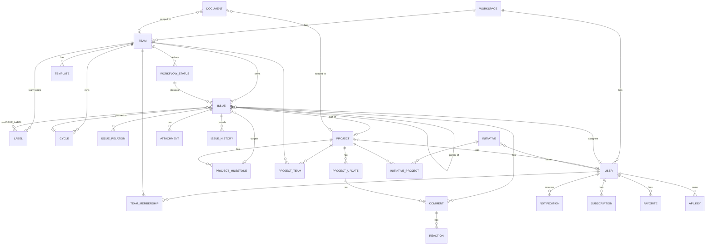

# Surface: Domain Model

Status: **Draft v0.1** · Date: 2026-11-06 · Implements: PRD §5 · Related: [glossary](glossary.md), [state machines](state-machines.md), [permissions](permissions.md), [events](events.md)

---

## 1. Conventions (all entities)

| Convention | Rule |
|---|---|
| **IDs** | `UUIDv7` (time-ordered). **Generated by the client** for optimistic creates, and validated for uniqueness by the server. |
| **Common fields** | `id`, `createdAt`, `updatedAt` (server-set, UTC), and `creatorId` where it makes sense |
| **Archive** | `archivedAt?`: set automatically (see state machines). Archived records stay in the replica. |
| **Trash** | `deletedAt?`: soft delete. The record is purged 30 days later, which produces a hard `delete` delta. |
| **Manual order** | `sortOrder`: a fractional-index string (e.g. `"a0V"`). It allows inserting between two rows without renumbering. |
| **Calendar dates** | `YYYY-MM-DD` with no timezone (due date, target date). Instants are `timestamptz`. |
| **Rich text** | Stored as editor JSON (ProseMirror) plus a derived `…Text` plain-text column used for search. |
| **Enums** | Stored as strings in the DB. Priority is a small int (0–4). |
| **Sync scope** | Every entity is **Synced** (in the replica, scoped by sync group), **User-scoped** (synced only to its owner), or **Server-only** (never sent to clients; read through admin queries). See [permissions.md](permissions.md). |

---

## 2. Entity index

| Area | Entity | Sync scope |
|---|---|---|
| Workspace | Workspace (singleton) | Synced (`workspace`) |
| Identity | User | Synced (`workspace`). Secret fields are server-only. |
| | Session, MagicLinkToken, PasswordResetToken, Invite, UserCredentials, TeamIssueCounter | Server-only |
| | ApiKey | User-scoped (the hash is server-only) |
| Teams | Team, TeamMembership | Synced (`workspace`, or `team:<id>` if private) |
| Workflow | WorkflowStatus, Label | Synced (inherits the team's scope; workspace labels use `workspace`) |
| Issues | Issue, IssueLabel, IssueRelation, Attachment, File, IssueHistory, IssueIdentifierAlias | Synced (inherits the issue's team scope) |
| | Comment, Reaction | Synced (inherits the parent's scope) |
| Planning | Cycle | Synced (team scope) |
| | Project, ProjectTeam, ProjectMember, ProjectMilestone, ProjectUpdate | Synced (derived from the project's teams; see permissions §3) |
| | Initiative, InitiativeProject | Synced (`workspace`) |
| Knowledge | Document, Template | Synced (inherits the scope it belongs to) |
| Personal | CustomView (shared) | Synced (workspace or team scope) |
| | CustomView (personal), ViewPreference, Favorite, Subscription, Notification | User-scoped |
| Platform | Webhook, WebhookDelivery, AuditLogEntry | Server-only (Admin queries) |

---

## 3. Entity relationship diagram (core)



---

## 4. Entities

> Fields marked 🔒 are server-only and never synced to clients.

### 4.1 Workspace (singleton)
| Field | Type | Notes |
|---|---|---|
| name | string (1–64) | |
| logoFileId | File? | |
| signupPolicy | `invite_only` \| `domain` | Default `invite_only` |
| allowedDomain | string? | Required when `signupPolicy = domain` |
| mcpEnabled | bool | Default `true` |
| updateReminder | `{ weekday, hour }?` | Schedule for project update reminders |
| defaults | json | Default settings for new teams |

### 4.2 User
| Field | Type | Notes |
|---|---|---|
| email | string | Unique, stored lowercase |
| name, displayName | string | displayName is unique and used for @mentions |
| avatarFileId | File? | |
| timezone | IANA tz | |
| role | `admin` \| `member` | |
| active | bool | Deactivated users can't log in, but remain referenced |
| passwordHash 🔒 | string? | argon2id, in the server-only **UserCredentials** row (§4.16), not on User: User is synced, and every write to it is broadcast. No row if the user only uses magic links. |
| lastSeenAt 🔒 | timestamptz | Not stored on User: the latest `Session.lastUsedAt` (§4.16). |
| preferences | → UserPreferences | Theme, home view, font size. A separate row (`UserPreferences`, id = the user's id, `values` json) synced to `user:<id>` only, because the User row itself is `workspace` (PLAN-001 S1). |

### 4.3 Team / TeamMembership
| Field | Type | Notes |
|---|---|---|
| key | string `^[A-Z]{2,5}$` | Unique. Changing it is v2. |
| name, icon, color | | |
| timezone | IANA tz | Drives cycle boundaries and automations |
| private | bool | |
| triageEnabled | bool | |
| defaultStatusId | WorkflowStatus | Must be in the Backlog or Unstarted category |
| estimateScale | `off` \| `linear` \| `exponential` \| `fibonacci` \| `tshirt` | |
| cyclesEnabled, cycleDurationWeeks (1–8), cycleCooldownWeeks (0–2), cycleStartWeekday (0–6), cycleUpcomingCount (1–15), cycleAutoAddStarted, cycleAutoAddCompleted | | Cycle settings |
| autoArchiveMonths | int? | Default 6 |
| autoCloseMonths | int? | Default null (off) |
| parentAutoComplete | bool | Default false |
| issueCounter 🔒 | int | Last issue number assigned. Kept in the server-only **TeamIssueCounter** row (§4.16), so taking a number isn't a sync delta. |

**TeamMembership:** `teamId`, `userId`, `triageResponsible: bool`. Unique on (`teamId`, `userId`).

### 4.4 WorkflowStatus
| Field | Type | Notes |
|---|---|---|
| teamId | Team | |
| name | string | Unique within the team |
| category | `triage` \| `backlog` \| `unstarted` \| `started` \| `completed` \| `canceled` \| `duplicate` | |
| color, description | | |
| position | fractional key | Order *within* the category (§1, manual order) |

### 4.5 Label / IssueLabel
| Field | Type | Notes |
|---|---|---|
| teamId | Team? | Null = workspace label |
| name, color, description | | Name is unique within its scope and parent |
| parentId | Label? | Set when this label belongs to a group |
| isGroup | bool | A group cannot be applied to an issue directly |

**IssueLabel:** (`issueId`, `labelId`). Unique on the pair.

### 4.6 Issue
| Field | Type | Notes |
|---|---|---|
| teamId | Team | |
| number | int? | Assigned by the server on commit. Null only while an optimistic create is pending. |
| title | string (1–255) | |
| description / descriptionText | doc / text | |
| statusId | WorkflowStatus | Must belong to `teamId` |
| priority | 0–4 | Default 0 |
| assigneeId | User? | Must be active and, if the team is private, a member |
| estimate | int? | Must be valid for the team's scale |
| dueDate | date? | |
| projectId | Project? | |
| projectMilestoneId | ProjectMilestone? | Must belong to `projectId` |
| cycleId | Cycle? | Must belong to `teamId` and must not be completed |
| parentId | Issue? | |
| sortOrder | fractional key | Global manual order |
| subIssueSortOrder | fractional key? | Order under the parent |
| startedAt, completedAt, canceledAt, triagedAt | timestamptz? | Maintained automatically from category changes |
| snoozedUntil | timestamptz? | Triage snooze only |
| archivedAt, deletedAt | timestamptz? | |

**Identifier** = `team.key + "-" + number`. It is derived, not stored.
**IssueIdentifierAlias:** `identifier` (unique), `issueId`. Written when an issue moves between teams, so old IDs keep resolving.

### 4.7 IssueRelation
| Field | Type | Notes |
|---|---|---|
| issueId | Issue | The *source* |
| relatedIssueId | Issue | The *target* |
| type | `blocks` \| `related` \| `duplicate` | `A blocks B` is stored once, and "B blocked by A" is its inverse view. `A duplicate B` means A is a duplicate of the canonical issue B. |

### 4.8 Comment / Reaction
| Field | Type | Notes |
|---|---|---|
| issueId \| projectUpdateId | | Exactly one is set |
| parentCommentId | Comment? | One level of replies only |
| userId | User | Author |
| body / bodyText | doc / text | |
| editedAt, deletedAt | | A deleted comment that has replies shows as "deleted" |

**Reaction:** `emoji`, `userId`, plus `commentId` or `projectUpdateId`. Unique on (user, emoji, target).

### 4.9 Attachment / File
- **Attachment:** `issueId`, `kind` (`file` | `link`), `fileId?`, `url?`, `title`, `creatorId`.
- **File:** `storageKey` 🔒, `name`, `mimeType`, `size`, `uploaderId`. Bytes live on the uploads volume and are served via an authorised URL.

### 4.10 IssueHistory
| Field | Type | Notes |
|---|---|---|
| issueId | Issue | |
| actorKind | `user` \| `api` \| `mcp` \| `system` | |
| actorId | User? | Null for `system` |
| apiKeyId | ApiKey? | For `api` and `mcp` |
| changes | json | `{ field: { from, to } }`. Also covers labels added or removed, relations, and team moves. |
| createdAt | | Changes within 3 minutes of creation by the creator are merged into the `created` entry |

### 4.11 Cycle
| Field | Type | Notes |
|---|---|---|
| teamId | Team | |
| number | int | Sequential per team |
| name, description | string? | Default display name is "Cycle N" |
| startsAt, endsAt | timestamptz | Computed in the team's timezone at 00:00 |
| completedAt | timestamptz? | |
| snapshot | json? | Frozen at completion: daily scope, started, and completed points |

### 4.12 Project & children
**Project**

| Field | Type | Notes |
|---|---|---|
| name, icon, color, summary | | |
| description / descriptionText | doc / text | Overview |
| status | `backlog` \| `planned` \| `in_progress` \| `paused` \| `completed` \| `canceled` | A fixed set in v1 |
| priority | 0–4 | |
| leadId | User? | |
| leadTeamId | Team | Must also appear in ProjectTeam |
| startDate, targetDate | date? | `startDate ≤ targetDate` |
| startedAt, completedAt, canceledAt | | Set automatically |
| sortOrder, archivedAt, deletedAt | | |

The other project entities:
- **ProjectTeam:** (`projectId`, `teamId`), unique.
- **ProjectMember:** (`projectId`, `userId`), unique.
- **ProjectMilestone:** `projectId`, `name`, `description`, `targetDate?`, `sortOrder`.
- **ProjectUpdate:** `projectId`, `authorId`, `health` (`on_track` | `at_risk` | `off_track`), `body`, `progressSnapshot` (json), `editedAt?`, `deletedAt?`.

### 4.13 Initiative
**Initiative:** `name`, `description`, `ownerId`, `status` (`planned` | `active` | `completed`), `targetDate?`, `sortOrder`, `archivedAt`, `deletedAt`.
**InitiativeProject:** (`initiativeId`, `projectId`) with a `sortOrder`. A project may belong to **several** initiatives.

### 4.14 Document / Template
- **Document:** `title`, `icon`, `content` / `contentText`, `teamId?`, `projectId?` (both null means workspace scope; at most one is set), `creatorId`, `sortOrder`, `deletedAt`.
- **Template:** `teamId`, `name`, `kind` (`issue`; `document` in v2), `data` (json: property defaults and description doc).

### 4.15 Views & personal data
- **CustomView:** `name`, `icon`, `model` (`issue` | `project`), `teamId?` (null means workspace scope), `ownerId`, `visibility` (`shared` | `personal`), `filters` (json, see [Filter model](#5-filter-model)), `display` (json), `sortOrder`.
- **ViewPreference:** (`userId`, `viewKey`), unique. `display` json holds personal overrides. `viewKey` is a custom view ID or a built-in key such as `team:<id>:active`.
- **ViewDefault:** (`viewKey`), with the shared default display for built-in views ("set as default for everyone").
- **Favorite:** `userId`, `targetType`, `targetId`, `sortOrder`.
- **Subscription:** (`userId`, `targetType` ∈ {issue, project}, `targetId`), unique. Also holds `reason` (`creator` | `assignee` | `mention` | `commenter` | `manual` | `lead` | `member`) and `active` (false = explicitly unsubscribed, so auto-subscribe does not re-add the user).
- **Notification:** `userId`, `type` (see [events.md](events.md)), `issueId?`, `projectId?`, `projectUpdateId?`, `commentId?`, `actorId?`, `data` (json), `groupKey` (e.g. `issue:<id>`), `readAt?`, `snoozedUntil?`, `deletedAt?`.

### 4.16 Identity, platform & audit (server-only unless noted)
| Entity | Key fields |
|---|---|
| Session | userId, tokenHash, userAgent, ip, createdAt, lastUsedAt, expiresAt |
| UserCredentials | userId (primary key), passwordHash (argon2id), updatedAt |
| TeamIssueCounter | teamId (primary key), lastNumber. Upserted when an issue is created. |
| Invite | email?, tokenHash, role, invitedById, expiresAt, acceptedAt?, revokedAt? |
| MagicLinkToken / PasswordResetToken | userId, tokenHash, expiresAt (15 min / 1 h), usedAt? |
| ApiKey (user-scoped) | userId, name, prefix (`sfc_xxxx`), keyHash 🔒, scope (`read` \| `read_write`), teamIds?, allowDestructive, lastUsedAt, revokedAt? |
| Webhook | url, secret 🔒, events[], enabled, createdById |
| WebhookDelivery | webhookId, event, payload, attempt, status, responseCode, nextAttemptAt |
| AuditLogEntry | actorId?, actorKind, action, targetType, targetId, ip, data, createdAt |

---

## 5. Filter model

A filter is a JSON tree shared by views, the API (`*.list`), and MCP:

```json
{ "and": [
    { "field": "status.category", "op": "in", "value": ["unstarted", "started"] },
    { "field": "assignee", "op": "eq", "value": "me" },
    { "or": [ { "field": "priority", "op": "lte", "value": 2 }, { "field": "label", "op": "in", "value": ["bug"] } ] },
    { "field": "updatedAt", "op": "gte", "value": "-P14D" }
] }
```

- **Operators:** `eq`, `neq`, `in`, `nin`, `lt`, `lte`, `gt`, `gte`, `exists`, `contains` (text).
- **Relative values:** `me`, `current`/`next`/`previous` for cycles, and ISO-8601 durations for dates.
- The client evaluates filters **locally** against the replica. The server evaluates the same tree for the API and MCP, so both share one implementation in the shared package.

---

## 6. Invariants

Each invariant must hold after every committed transaction. The server enforces them, and each has a test.

| ID | Invariant |
|---|---|
| INV-01 | Exactly one Workspace exists. At least one **active Admin** exists at all times. |
| INV-02 | `User.email` is unique (case-insensitive). `User.displayName` is unique (case-insensitive: it is the @mention handle). |
| INV-03 | `Team.key` is unique and matches `^[A-Z]{2,5}$`. |
| INV-04 | Every team has ≥ 1 status in each of the categories Backlog, Unstarted, Started, Completed, and Canceled. It has exactly one system Duplicate status, and exactly one Triage status (which exists even when triage is disabled). |
| INV-05 | `Team.defaultStatusId` refers to a status of that team in the Backlog or Unstarted category. |
| INV-06 | `Issue.statusId`, `Issue.cycleId`, and every team-scoped label on an issue belong to `Issue.teamId`. |
| INV-07 | An issue has at most one label per label group. Groups themselves are never applied to issues. Label groups are one level deep. |
| INV-08 | `(teamId, number)` is unique among issues and never reused, even after purge. |
| INV-09 | An issue's parent chain has no cycles. `parentId ≠ id`. |
| INV-10 | `IssueRelation`: no self-relations. At most one relation per (unordered pair, type). An issue has at most one `duplicate` relation as the source. |
| INV-11 | An issue is in the **Duplicate** category if and only if it is the source of a `duplicate` relation. |
| INV-12 | `Issue.projectMilestoneId` is set only if it belongs to `Issue.projectId`. Changing the project clears the milestone. |
| INV-13 | `Issue.cycleId` never points to a completed cycle for an open issue. Closed issues may stay in completed cycles. |
| INV-14 | A Triage-category issue has no `cycleId`. |
| INV-15 | Each team's cycles don't overlap and are numbered consecutively. |
| INV-16 | `Project.leadTeamId` ∈ the project's ProjectTeam rows. A project has ≥ 1 team. |
| INV-17 | An issue's team must be one of its project's teams. Adding an issue to a project adds the issue's team to the project automatically. |
| INV-18 | The assignee of an issue in a private team is a member of that team. Removing a member unassigns them from that team's open issues. |
| INV-19 | Comment replies are one level deep: a reply's parent has no parent. |
| INV-20 | Timestamps (`startedAt`, `completedAt`, `canceledAt`) are consistent with the current status category (see [state machines](state-machines.md) §1). |
| INV-21 | Purged records leave no dangling references: references are nulled, or rows cascade-deleted, per the rules in permissions §6. |
| INV-22 | `Document` has at most one of `teamId` / `projectId`. |

---

## 7. Operations catalogue (seed for the Operation Registry)

The domain is changed **only** through operations. This first-pass list will be refined in the specs.

| Domain | Queries | Mutations |
|---|---|---|
| workspace | `workspace.get` | `workspace.update` |
| user | `user.list`, `user.get`, `user.me` | `user.updateProfile`, `user.setRole`, `user.deactivate`, `user.reactivate` |
| invite | `invite.list` | `invite.create`, `invite.revoke` |
| team | `team.list`, `team.get` | `team.create`, `team.update`, `team.setPrivacy`, `team.addMember`, `team.removeMember`, `team.join`, `team.leave` |
| status | `status.list` | `status.create`, `status.update`, `status.reorder`, `status.delete` (with replacement) |
| label | `label.list` | `label.create`, `label.update`, `label.delete` |
| issue | `issue.get`, `issue.list`, `issue.search`, `issue.count`, `issue.groupBy` | `issue.create`, `issue.bulkCreate`, `issue.update`, `issue.bulkUpdate`, `issue.moveTeam`, `issue.setParent`, `issue.delete`, `issue.restore`, `issue.archive`, `issue.unarchive` |
| relation | — | `relation.create`, `relation.delete`, `issue.markDuplicate` |
| comment | `comment.list` | `comment.create`, `comment.update`, `comment.delete`, `reaction.toggle` |
| attachment | — | `attachment.createLink`, `attachment.uploadFile`, `attachment.delete` |
| triage | `triage.list` | `triage.accept`, `triage.decline`, `triage.snooze` |
| cycle | `cycle.list`, `cycle.get`, `cycle.current`, `cycle.progress` | `cycle.update`, `team.updateCycleSettings` |
| project | `project.list`, `project.get`, `project.progress` | `project.create`, `project.update`, `project.delete`, `project.restore`, `project.addTeam`, `project.removeTeam`, `project.addMember`, `project.removeMember` |
| milestone | — | `milestone.create`, `milestone.update`, `milestone.reorder`, `milestone.delete` |
| update | `projectUpdate.list` | `projectUpdate.create`, `projectUpdate.update`, `projectUpdate.delete` |
| initiative | `initiative.list`, `initiative.get` | `initiative.create`, `initiative.update`, `initiative.addProject`, `initiative.removeProject`, `initiative.delete` |
| document | `document.list`, `document.get` | `document.create`, `document.update`, `document.delete`, `document.restore` |
| template | `template.list` | `template.create`, `template.update`, `template.delete` |
| view | `view.list`, `view.get` | `view.create`, `view.update`, `view.delete`, `view.setDefaultDisplay` |
| personal | `notification.list`, `favorite.list` | `notification.markRead`, `notification.snooze`, `notification.delete`, `subscription.set`, `favorite.add`, `favorite.remove`, `favorite.reorder` |
| platform | `apiKey.list`, `webhook.list`, `audit.list` | `apiKey.create`, `apiKey.revoke`, `webhook.create`, `webhook.update`, `webhook.delete` |
| io | — | `import.csv`, `export.csv`, `export.workspace` |
