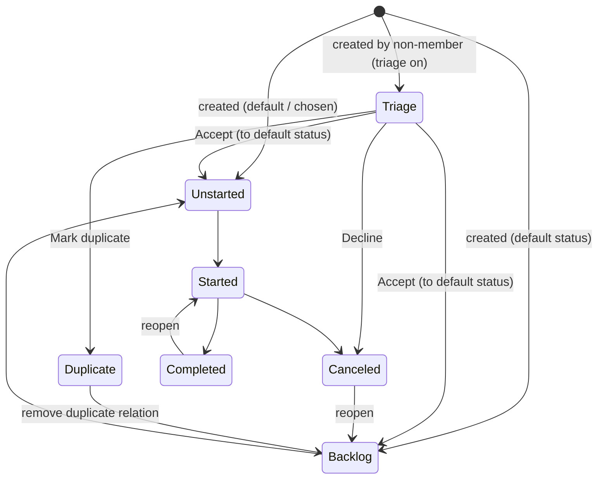
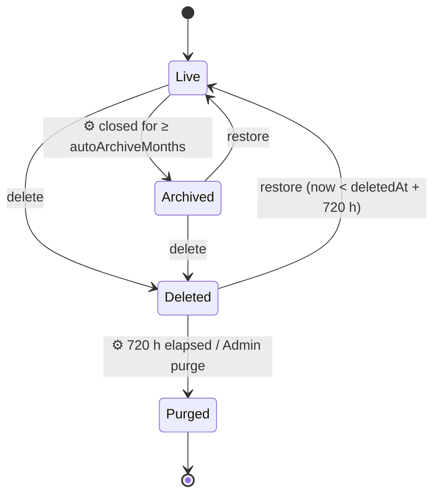
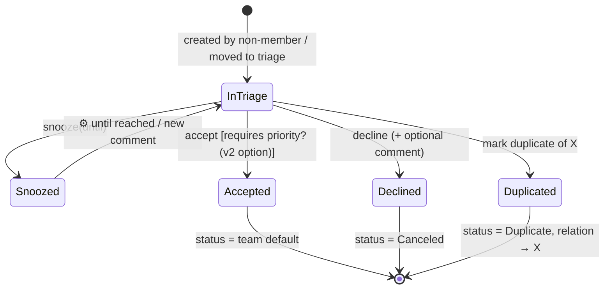
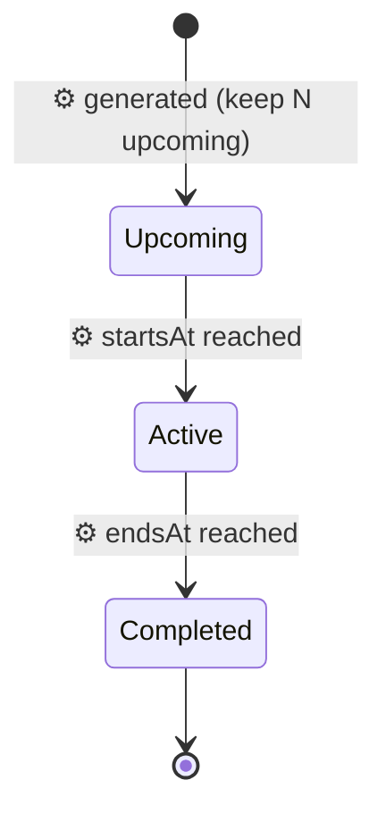
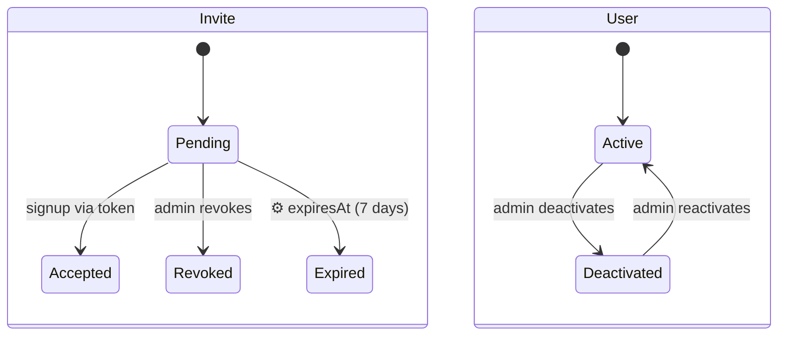
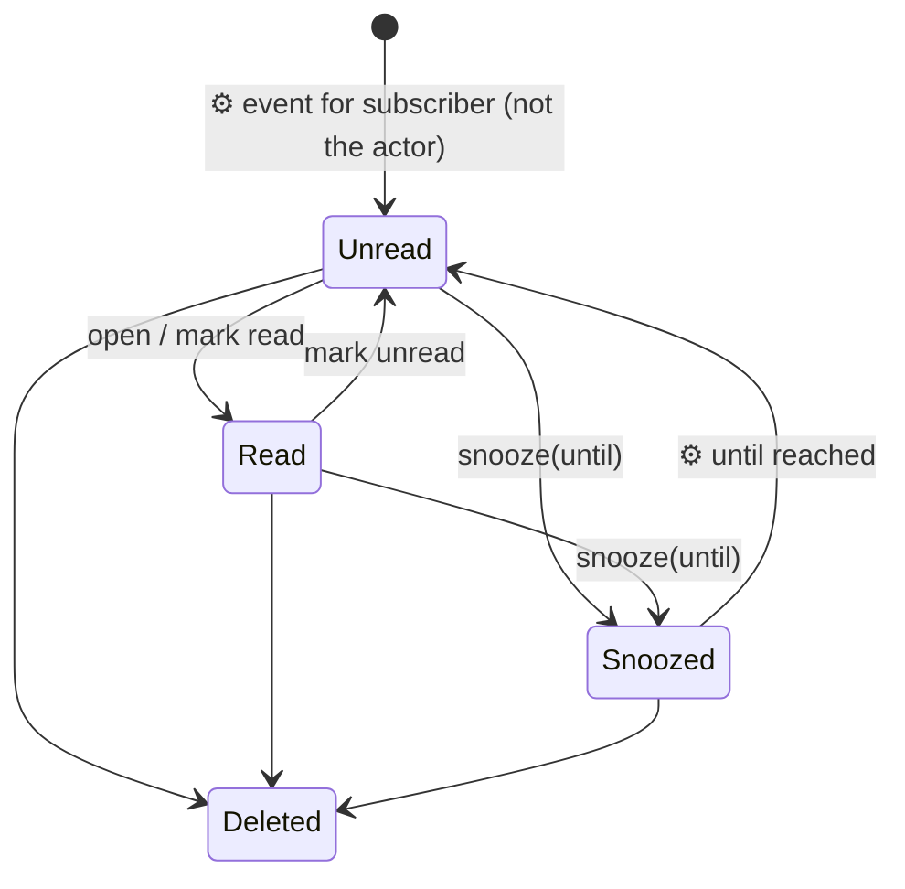
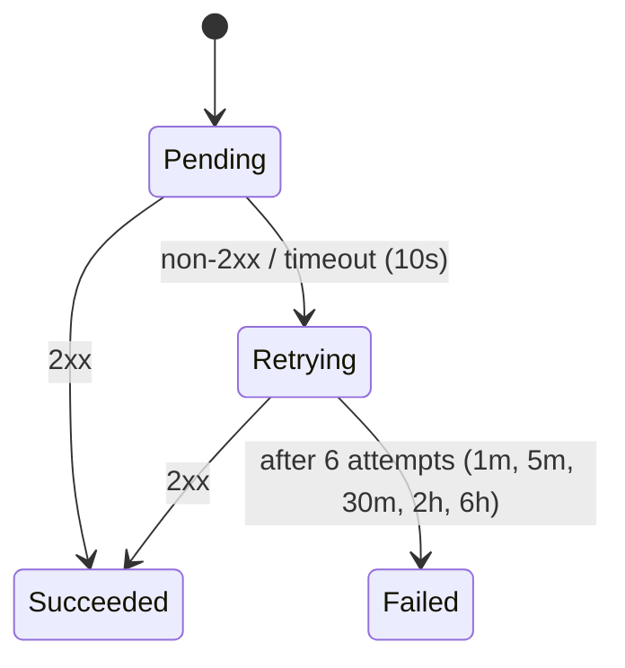

# Surface: State Machines & Lifecycle Rules

Status: **Draft v0.1** · Date: 2026-11-06 · Related: [domain-model](domain-model.md), [events](events.md)

*Changed 2026-11-12 (M1 acceptance gate, SPEC-011, SPEC-014 and SPEC-015 §12): §2 rewritten. Archive is automatic only, archived and deleted issues are read-only, restore is the one way back from both states, and "Trashed" is now "Deleted" (shown as Recently deleted).*

Automated transitions (marked ⚙️) run **server-side** inside the same transaction as their trigger, or in the background job queue (pg-boss) for time-based rules. Every automated change is written to history with `actorKind = system`.

---

## 1. Issue status categories

Users may move an issue from any status to any other status, *except* where noted. Side effects depend only on the **category** being entered or left.

| Entering category | Side effects ⚙️ |
|---|---|
| **Started** | Set `startedAt` if null. Clear `completedAt` and `canceledAt`. If cycle auto-add is on and the issue has no cycle, add it to the current cycle (or the next one during a cooldown). |
| **Completed** | Set `completedAt`. Clear `canceledAt`. If cycle auto-add is on and the issue has no cycle, add it to the current cycle (or the *previous* one during a cooldown). If `parentAutoComplete` is on and all siblings are closed, complete the parent too. |
| **Canceled** | Set `canceledAt`. Clear `completedAt`. |
| **Duplicate** | Only reachable through `issue.markDuplicate` (INV-11). Sets `canceledAt`. |
| **Backlog / Unstarted** (from a closed category) | Clear `completedAt` and `canceledAt` (this is a reopen). |
| **Triage** | Only on creation, or through an explicit "Move to triage". Clears `cycleId` (INV-14). |

| Leaving category | Side effects ⚙️ |
|---|---|
| **Triage** | Set `triagedAt`. Clear `snoozedUntil`. |
| **Duplicate** | Only by deleting the duplicate relation. The issue goes to the team's default status. |

Cross-cutting rules ⚙️:
- **Adding to a cycle** promotes an issue in the Backlog category to the first Unstarted status.
- **Removing from a cycle** never changes status.
- **Leaving any closed category** (a reopen) makes the issue eligible for rollover again.

---

## 2. Issue lifecycle (archive & delete)

An issue is in exactly one state: **Live** (`archivedAt` and `deletedAt` null), **Archived** (`archivedAt` set, `deletedAt` null), **Deleted** (`deletedAt` set, whatever `archivedAt` is) or **Purged** (the row is gone). The rules are in SPEC-015 §4.

- **Archived:** archive is **automatic only** ⚙️. A daily job archives Live issues in a Completed or Canceled category (Duplicate included) once `greatest(completedAt, canceledAt, updatedAt)` is `autoArchiveMonths` old (the team's setting: 1, 3, 6, 9 or 12 months, default 6). Nobody archives or unarchives an issue by hand, and no edit unarchives one. An archived issue is not held in the client replica ([ADR-0020](../04-architecture/adr/0020-partial-issue-sync.md)); it is shown on the team archive page, read from the server.
- **Deleted** (shown as **Recently deleted**): hidden everywhere except the Recently deleted tab of the team archive page. `archivedAt` is kept until a restore. Relations are kept so a restore is lossless.
- **Restore:** `Archived → Live` and `Deleted → Live` are both **restore** (`issue.restore`), which clears both states and sets `updatedAt` to now, so the archive job doesn't archive the issue again at once. A deleted issue can be restored while `now < deletedAt + 720 h` (30 × 24 h in UTC); from that moment it can only be purged, even if the purge job hasn't run yet.
- **Read-only:** archived and deleted issues are read-only. Every direct edit by a person, an API key or MCP (fields, description, labels, comments, reactions, attachments) is `CONFLICT` until the issue is restored. Settings cascades (a label delete) and system jobs still write them and leave their state alone (SPEC-015 §4.3).
- **Children follow their issue:** content, history, comments, reactions and attachments keep their own rows and states. They are not archived or deleted row by row; the client shows or hides them with their issue.
- **Sub-issues:** deleting a parent deletes its sub-issues (M3; SPEC-015 §4.7).
- **Purged:** a hard delete. Comments, reactions, attachments, history, content, relations and subscriptions are deleted, and notifications pointing to it are deleted. Every file row the issue owns is deleted, and its bytes are removed by `files-cleanup` after commit, only when no other file row uses them (SPEC-014 §4.5). The Issue and its Attachments each log a `D` delta; content rows log none (SPEC-015 §4.5). Purge writes no history entry. The issue number is **not** reused (INV-08).
- **Auto-close** ⚙️ (optional, off by default): Live issues in Backlog, Unstarted, or Started that haven't been updated for ≥ `autoCloseMonths` move to the team's auto-close status (a Canceled status, `autoCloseStatusId`), with a history entry by the system actor ("Issue was automatically closed"), not a system comment. Comments, reactions and attachments don't move `updatedAt`, so they don't count as activity. Turning auto-close off clears its status, and turning it on again with no status picks the team's first Canceled status (SPEC-015 D21, 2026-11-16).
- The three jobs (`auto-close`, `auto-archive`, `trash-purge`) run daily in UTC, as the system actor, one issue per transaction (SPEC-015 §6.3).

Projects, documents, and initiatives follow the same Live → Deleted → Purged lifecycle. Projects and cycles also archive ⚙️ automatically after `autoArchiveMonths` once they are completed or canceled.

---

## 3. Triage flow

- **Entry rule:** an issue is created in the Triage status when the team has `triageEnabled` and the creator is **not** a member of the team. A member can also choose "Move to triage".
- **Responsible members** (`triageResponsible`) get a notification for every new triage issue.
- **Disabling triage** moves all issues currently in triage to the team's default status ⚙️ (with confirmation).

---

## 4. Cycle lifecycle

A background job runs **each hour** and handles every team whose local midnight boundary has passed:

1. **Complete** active cycles whose `endsAt ≤ now`:
   1. Freeze `snapshot` (the graph data).
   2. **Rollover** ⚙️: every *open* issue in the cycle moves to the next cycle. Issues in Backlog or Triage, and closed issues, stay put.
   3. Set `completedAt`.
2. **Activate** upcoming cycles whose `startsAt ≤ now`.
3. **Generate** new upcoming cycles until there are `cycleUpcomingCount` of them. Each starts after the previous cycle's end plus the cooldown.

The job is **idempotent**: each step is keyed by (`cycleId`, step), so a crash or restart mid-run never double-rolls.

**Settings changes** (duration, weekday, cooldown) regenerate only *upcoming cycles that have no issues*. Upcoming cycles that already have issues keep their dates (the user is warned).
**Disabling cycles** completes the active cycle (with rollover cleared, so issues lose their cycle), deletes the upcoming cycles, and keeps the completed ones.

---

## 5. Project status

Users can move a project between any of the statuses `backlog`, `planned`, `in_progress`, `paused`, `completed`, and `canceled`.

| Entering | Side effects ⚙️ |
|---|---|
| `in_progress` | Set `startedAt` if null |
| `completed` | Set `completedAt`. If there are open issues, the UI warns (and offers to cancel or move them); they stay open by default. |
| `canceled` | Set `canceledAt` |
| any other status, from completed or canceled | Clear `completedAt` / `canceledAt` |

**Update reminders** ⚙️: a weekly job (`Workspace.updateReminder`) notifies the **lead** of each `in_progress` project that has had no update in the last 6 days.

---

## 6. Users, invites & auth

- **Deactivate** ⚙️: delete all sessions, revoke API keys, remove the user from team triage responsibility, and **unassign** their open issues (a history entry is recorded). Their authored content is kept.
- **Demote an Admin:** rejected if it would leave no active Admin (INV-01).
- **Tokens:** a magic link is single-use, lasts 15 minutes, and invalidates the user's other unused magic links. A password reset is single-use, lasts 1 hour, and on use logs out the user's other sessions.

---

## 7. Notifications

- Users are **never notified of their own actions**.
- **Grouping:** a new event with the same `groupKey` while one is Unread **updates** that notification (adds the event, bumps the time) instead of creating a new row.
- **Retention:** read notifications are deleted ⚙️ after 90 days. Each user keeps at most 2,000 (the oldest read ones are removed first).

---

## 8. Webhook delivery

- After 20 consecutive failed deliveries, the webhook is **auto-disabled** ⚙️, an Admin is notified, and the event is recorded in the audit log.
