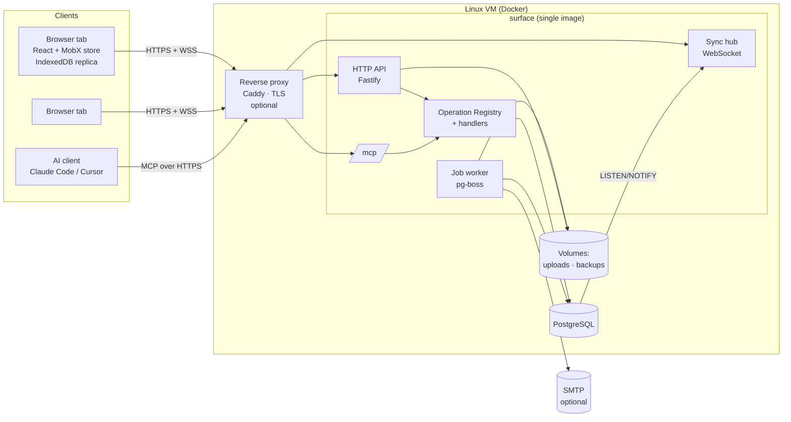
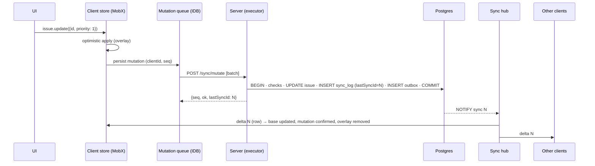

# Surface: System Architecture

Status: **Draft v0.1** · Date: 2026-11-06 · Inputs: [VISION](../01-vision/VISION.md), [PRD](../02-product/PRD.md), [domain](../03-domain/domain-model.md)
Companion docs: [`sync-protocol.md`](sync-protocol.md) · [`mcp-design.md`](mcp-design.md) · [`adr/`](adr/)

---

## 1. Architecture at a glance

Surface is a **local-first web app** with one **authoritative server**:

- **The client** holds a replica of everything the user can see: all **metadata** eagerly, and heavy **content** (descriptions, comments, history, document bodies) loaded on demand and cached. The UI reads only from the in-memory store, so interactions never wait on the network.
- **Every change is an operation** from the Operation Registry. The client applies it optimistically and sends it to the server. The server runs it authoritatively, commits it to Postgres with a global `lastSyncId`, and broadcasts the resulting row changes (**deltas**) over WebSocket to every client that can see them.
- **One container plus Postgres** on a Linux VM. No other services are required.



---

## 2. Technology stack

| Concern | Choice | ADR |
|---|---|---|
| Language | TypeScript everywhere, strict mode | [0001](adr/0001-monorepo-typescript.md) |
| Repo | pnpm workspaces + Turborepo | 0001 |
| Runtime (server) | Node.js LTS (24.x) | 0001 |
| HTTP / WebSocket | Fastify + `@fastify/websocket` | [0005](adr/0005-api-surface.md) |
| Database | PostgreSQL 17+ | [0006](adr/0006-postgres-drizzle.md) |
| DB access & migrations | Drizzle ORM + drizzle-kit (raw SQL for the sync hot path) | 0006 |
| Validation & schemas | Zod (shared between client and server, exported to JSON Schema) | [0011](adr/0011-operation-registry.md) |
| Sync | Custom engine (this repo) | [0002](adr/0002-sync-strategy.md) |
| Client state | MobX observable object graph | [0003](adr/0003-client-state-mobx.md) |
| Web app | React 19 + Vite, TanStack Router, TanStack Virtual, Radix primitives, CSS Modules + CSS-variable tokens | [0004](adr/0004-web-stack.md) |
| Rich text | TipTap (ProseMirror), stored as JSON | [0009](adr/0009-editor-tiptap.md) |
| Search | Client: FlexSearch in a Web Worker. Server: Postgres FTS + `pg_trgm`. MCP operations: MiniSearch. | [0008](adr/0008-search.md) |
| Background jobs | pg-boss (runs on Postgres) | [0010](adr/0010-jobs-pg-boss.md) |
| Auth | Sessions in Postgres, argon2id, HTTP-only cookies, SMTP via Nodemailer | [0007](adr/0007-auth.md) |
| Files | Local volume behind a `BlobStore` interface | [0014](adr/0014-file-storage.md) |
| MCP | Two structured tools on the official MCP TypeScript SDK | [0012](adr/0012-mcp-shape.md) |
| Packaging | One Docker image, `docker-compose.yml` (app + db), optional Caddy | [0013](adr/0013-deployment-docker.md) |
| Logs / metrics | pino (JSON to stdout), optional Prometheus `/metrics` | 0013 |
| Tests | Vitest, fast-check (property tests), Playwright (e2e + perf) | §9 |

---

## 3. Monorepo layout

```
surface/
├─ apps/
│  ├─ web/                 React SPA (served as static files by the server)
│  └─ server/              Fastify: HTTP API, sync hub, MCP, auth, jobs, operation handlers
├─ packages/
│  ├─ domain/              Entity types, enums, invariants, filter engine, fractional indexing
│  ├─ operations/          Operation definitions (name, schemas, permission, keywords, examples,
│  │                       optimistic() for the client), shared by client and server
│  ├─ sync-client/         IndexedDB store, MobX object pool, mutation queue, rebase, WS client
│  ├─ sync-protocol/       Wire types (bootstrap frames, delta packets, mutation batches) + codecs
│  ├─ ui/                  Design system components and tokens
│  ├─ editor/              TipTap config, extensions (mentions, issue chips), JSON ↔ text
│  └─ config/              tsconfig, eslint, vitest presets
├─ docker/                 Dockerfile, compose files, Caddyfile example
└─ docs/
```

**Dependency rule:** `domain` ← `operations` ← (`sync-client`, `apps/server`). `apps/web` depends on `sync-client`, `ui`, and `editor`. The server never imports UI packages, and the client never imports server code.

---

## 4. Runtime components (inside the one container)

| Component | Responsibility |
|---|---|
| **HTTP API** | Auth routes, `POST /api/ops/:name`, `POST /sync/mutate`, `GET /sync/bootstrap`, `GET /sync/content`, file upload and download, static web app, `/healthz` and `/readyz` |
| **Operation executor** | Authenticate → scope check → resolve references → permission check → run handler in a DB transaction → append sync log and event outbox → commit |
| **Sync hub** | One WebSocket per tab. Sends catch-up deltas, then live deltas filtered by the user's sync groups. Also relays ephemeral presence messages. |
| **MCP endpoint** | `/mcp`: `search_operations` (MiniSearch over the registry) and `execute_operation` (calls the operation executor) |
| **Job worker** | pg-boss queues: cycle transitions, rollover, notification fan-out, emails, webhooks, auto-archive and auto-close, trash purge, update reminders, backups, sync-log pruning |
| **Outbox consumers** | Turn domain events into history, notifications, webhooks, and audit entries ([events.md](../03-domain/events.md)) |

`SURFACE_ROLE` = `all` (default) | `web` | `worker` allows the components to be split into separate containers later. A single process is the default.

---

## 5. Key flows

### 5.1 Startup of a client
1. The SPA loads (static, cacheable) and reads the IndexedDB metadata (`schemaHash`, `lastSyncId`).
2. **Warm start:** the in-memory store hydrates from IndexedDB, the UI is interactive, and the WebSocket connects with `since=lastSyncId` to receive catch-up deltas.
3. **Cold start** (no local data, or a schema mismatch): `GET /sync/bootstrap` streams all visible metadata as NDJSON into IndexedDB and memory progressively, then the WebSocket connects.

### 5.2 A user changes an issue's priority


### 5.3 MCP and API calls
`execute_operation` and `POST /api/ops/:name` call the **same executor**. Deltas reach every open client exactly as if the change had been made in the UI. The actor is recorded as `mcp` or `api`.

### 5.4 Time-based automation
The cycle job runs hourly: complete, roll over, activate, generate (idempotent steps), all through the executor with `actor = system`.

---

## 6. Data architecture

- **Postgres tables** mirror the [domain model](../03-domain/domain-model.md). Every synced table has a `sync_groups text[]` column (GIN-indexed), maintained by the handlers.
- **`sync_log`** holds `sync_id bigint PK`, `model`, `model_id`, `action`, `data jsonb`, `groups text[]`, `client_id`, `client_seq`, and `created_at`. It is the source of deltas. Its ordering guarantee is described in [sync-protocol §3](sync-protocol.md#3-server-ordering-lastsyncid).
- **`event_outbox`** stores domain events consumed by pg-boss jobs.
- **Server-side full-text:** `tsvector` columns on issues, comments, and documents, plus `pg_trgm` on identifiers and titles.
- **Retention:** `sync_log` is pruned after 30 days; clients older than that re-bootstrap. The outbox is pruned after processing plus 7 days. The audit log is kept 1 year.

---

## 7. Client architecture

```
React components ──observe──► MobX object pool (models by id, computed indexes)
        │                              ▲
        │ dispatch(op, input)          │ base rows ⊕ pending overlay
        ▼                              │
 Operation runner ──optimistic()──► Store ◄── deltas ── WebSocket client
        │                                                     ▲
        ▼                                                     │
 Mutation queue (IDB) ── POST /sync/mutate ──► server ────────┘
        │
 Undo stack (inverse ops)        Search worker (FlexSearch)      IDB writer worker
```

- **Object pool:** typed model classes with observable fields and computed back-references (e.g. `team.issues`, `issue.children`).
- **Secondary indexes** are maintained incrementally: by team, status, assignee, cycle, project, and label. Views evaluate filters against these indexes instead of scanning all issues.
- **Lazy content** (descriptions, comments, history, doc bodies) is fetched per parent with `GET /sync/content` and cached in IDB. It is **prefetched** for issues the user is likely to open: assigned to them, in the current cycle, or hovered or visible in a list.
- **Workers:** a dedicated worker writes to IndexedDB and another runs the search index, keeping the main thread free.
- **Multiple tabs:** each tab has its own WebSocket and memory store, and all tabs share IndexedDB. A `BroadcastChannel` tells other tabs to reload changed rows. (A SharedWorker-based single connection is a possible later optimisation.)

---

## 8. Cross-cutting concerns

| Concern | Approach |
|---|---|
| **Authorisation** | Sync groups for visibility, plus the permission matrix in the executor ([permissions.md](../03-domain/permissions.md)) |
| **Validation** | Zod at the edge, plus invariants inside DB transactions (FK, unique, check constraints, and handler checks) |
| **Idempotency** | `(clientId, seq)` dedupe on `/sync/mutate`. `clientMutationId` on the API and MCP. Job steps keyed by entity and step. |
| **Errors** | Typed codes: `INVALID_INPUT`, `NOT_FOUND`, `FORBIDDEN`, `CONFLICT`, `RATE_LIMITED`, `CLIENT_OUTDATED`, `INTERNAL` |
| **Rate limits** | Per IP on auth. Per session and per API key on mutations. |
| **Security headers** | Strict CSP (no inline scripts except the theme bootstrap, allowed by its hash: SPEC-004 §15), HSTS behind the proxy, SameSite=Lax cookies, CSRF token on cookie-auth POSTs |
| **Observability** | Request and operation logs with duration and actor. Metrics: op latency, sync lag (commit → broadcast), WS connections, job queue depth, bootstrap size and time. |
| **Config** | Only environment variables (`SURFACE_URL`, `DATABASE_URL`, `SESSION_SECRET`, `SMTP_URL`, `UPLOAD_MAX_MB`, `MCP_ENABLED`, `BACKUP_SCHEDULE`, `BACKUP_RETENTION`, `SURFACE_ROLE`) |
| **Versioning** | SemVer. Each release bumps `schemaHash` when synced models change. The server rejects outdated clients with `CLIENT_OUTDATED`, and the client reloads. |

---

## 9. Testing architecture

| Suite | What it proves |
|---|---|
| **Domain unit** | Invariants, state machines, filter engine, fractional indexing |
| **Operation contract** | Each operation's examples validate and run against a seeded DB. Permission matrix tests. |
| **Sync simulation** | An in-process server plus N simulated clients with a controllable network (delay, drop, reorder, disconnect). **Property test (fast-check):** after random operations and network chaos, every client's store converges to the server state. Pending mutations are never lost or applied twice. |
| **Isolation** | The private-team leak checklist ([permissions §5](../03-domain/permissions.md#5-leak-checklist-must-be-covered-by-tests)) |
| **E2E (Playwright)** | PRD journeys J1–J8, keyboard-driven, with two browsers for real-time checks |
| **Performance** | A seeded reference-scale workspace (NFR-10). Budgets are asserted in CI: interaction p95, warm start, bootstrap time, sync lag. |
| **Install** | A clean-VM `docker compose up` smoke test on every release |

---

## 10. Deployment (reference)

```
/opt/surface/
├─ docker-compose.yml      services: app (surface image), db (postgres:17); optional profile: proxy (caddy)
├─ .env                    SURFACE_URL, SESSION_SECRET, DATABASE_URL, SMTP_URL …
└─ volumes: pgdata, uploads, backups
```

- `docker compose up -d`, then open `SURFACE_URL` and complete first-run setup.
- **Upgrade:** bump the image tag, then `docker compose up -d`. Migrations run on start, guarded by an advisory lock.
- **Backup:** a nightly job runs `pg_dump` plus a tar of the uploads into the `backups` volume (14 kept by default). **Restore:** `docker compose run app surface restore <file>`.
- **Minimum VM:** 2 vCPU, 2 GB RAM, 20 GB disk (NFR-12).
