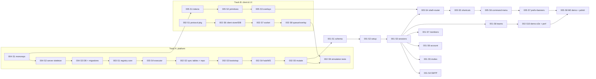

# M0 Implementation Plans: Overview

Status: **Ready** · Date: 2026-11-06 · Milestone: **M0 Foundations** · Specs: [06-specs](../06-specs/README.md) (all Accepted)

---

## 1. Plans

| Plan | Implements | Slices | Size |
|---|---|---|---|
| [PLAN-004](PLAN-004-packaging-ops-baseline.md) | SPEC-004 Repository, CI & packaging | 8 | ~9 d |
| [PLAN-003](PLAN-003-operation-registry-executor.md) | SPEC-003 Operation Registry & executor | 7 | ~10 d |
| [PLAN-002](PLAN-002-sync-engine-v0.md) | SPEC-002 Sync engine v0 | 10 | ~18 d |
| [PLAN-001](PLAN-001-workspace-auth-members-teams.md) | SPEC-001 Auth, members & teams | 9 | ~13 d |
| [PLAN-005](PLAN-005-app-shell-command-menu-shortcuts.md) | SPEC-005 Shell, command menu & shortcuts (+ design-system foundations) | 8 | ~13 d |

**Sizes:** S ≤ 1 day · M 2–3 days · L 4–5 days, in ideal engineering days for one person. The total is about **63 ideal days**, which is roughly 3 calendar months for one engineer or about 6 weeks for two, using the parallel tracks below.

## 2. Dependency graph & tracks

**Critical path:** 004·S1–S3 → 003·S1–S4 → 002·S2–S5 → 001·S1–S3 → 005·S4–S8.
**Parallel work:** Track B (tokens, primitives, overlays, client store) can start as soon as the monorepo exists. That is the natural split if there are two people.

## 3. Suggested sequence (two engineers)

| Week | Engineer 1 (platform) | Engineer 2 (client/UI) |
|---|---|---|
| 1 | 004·S1–S4 | 004·S5–S6 (Docker, CI) → 005·S1 |
| 2 | 003·S1–S4 | 005·S2–S3 · 002·S1 |
| 3 | 003·S5–S7 · 002·S2 | 002·S6–S7 |
| 4 | 002·S3–S5 | 002·S8 · 004·S7–S8 (docs, install smoke) |
| 5 | 002·S9 · 001·S1–S3 | 005·S4 (shell on the real store) |
| 6 | 001·S4–S7 | 005·S5–S6 |
| 7 | 001·S8–S9 · 002·S10 | 005·S7–S8 |

## 4. Conventions for every slice

- **One slice = one PR** (or a short stack), independently mergeable with CI green. Name the branch `p<plan>-s<slice>-<topic>` (e.g. `p002-s4-sync-hub`).
- **The PR description** links the plan slice and lists the spec ACs it covers.
- **Definition of Done** ([METHODOLOGY §5](../METHODOLOGY.md#5-working-rhythm)): tests for the covered ACs, lint/typecheck green, docs updated, and new operations pass the registry lint. UI slices also need Storybook stories and the axe check.
- **Feature flags are not needed in M0.** Nothing is user-facing until the M0 demo.
- **If a slice reveals a spec problem,** update the spec (and an ADR if needed) in the same PR. Never leave the code and spec disagreeing.

## 5. M0 exit checklist

- [ ] **Demo (METHODOLOGY M0):** two tabs, rename a team in one, and it updates in the other in < 150 ms. The change survives an offline reload.
- [ ] **Keyboard-only demo** (SPEC-005 AC-1)
- [ ] **Install smoke:** fresh VM to first team in < 15 min (SPEC-004 AC-3)
- [ ] **Sync property suite** at 1,000 cases green on main (SPEC-002 AC-2/3)
- [ ] All ACs of SPEC-001 to SPEC-005 have passing tests
- [ ] Release `v0.1.0` image published (amd64 + arm64)
- [ ] Retro held. PRD and METHODOLOGY updated with what we learned. M1 specs (SPEC-010+) are next.
